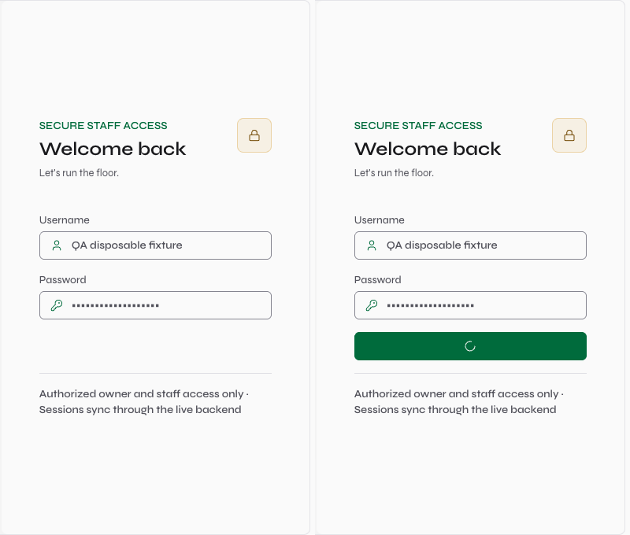
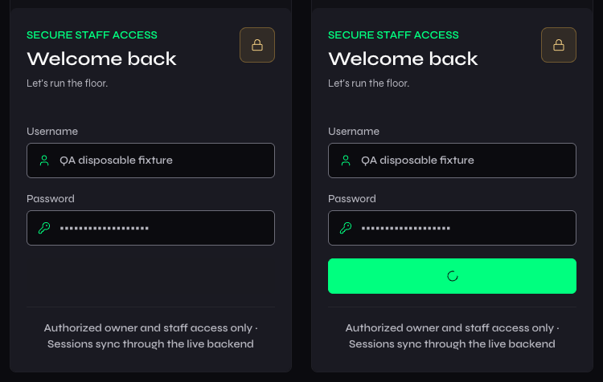
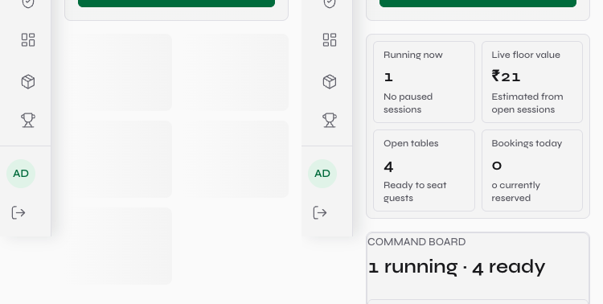
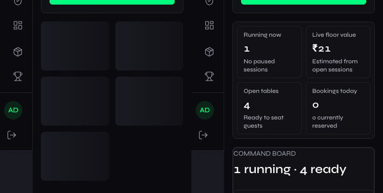

# Phase 1: reliability

Work is isolated on `codex/daily-use-readiness-audit`. Merge and deployment require
the owner's approval after this checkpoint. Palette, fonts and SSE scope are unchanged.

## Changes

- Shared in-flight readiness request: 10-second attempts within a 75-second total
  wake budget, with bounded read-only retry/backoff. Login waits for readiness,
  then submits credentials once. This does not automatically retry writes.
- Ordinary API reads have a 30-second total budget and at most two retries;
  attempts default to 15 seconds. Cancellation and client errors are not retried.
- Existing server banner remains visible while waking. Health-check generations
  prevent stale completions overwriting current status. Recovery invalidates page
  reads through the existing refresh event rather than inventing another transport.
- Production refuses missing/non-Postgres database configuration. Existing local
  SQLite development remains supported. Postgres pool is 5 + 5 overflow, with a
  5-second pool/connect wait and 300-second connection recycling plus pre-ping.
- Each Postgres transaction sets local 10-second statement, 5-second lock and
  15-second idle-in-transaction limits. They do not leak into later pooled
  transactions. One `set_config(..., true)` query applies all three limits,
  equivalent to `SET LOCAL` without three remote round trips. Psycopg automatic
  prepared statements are disabled for pooler
  compatibility. No schema or business-record migration is included.
- GitHub Actions pings every ten minutes around the owner-confirmed 11 AM-2 AM
  IST shift: scheduled requests from 10:57 AM to 2:07 AM IST. The scheduler is free
  for standard public-repository runners. GitHub's public repository API confirmed
  `private: false` for KingShivesh/hsr-bms; private repository allowance differs.
- Fixed a reproduced Live Floor loading race: a background refresh could supersede
  the first request, populate the state, but never clear the initial skeleton.
  The latest completed request now clears loading, regardless of what started it.
- Pending native buttons no longer inherit the generic disabled fill or hide
  their spinner through transparent inherited text. Ordinary disabled controls
  are unchanged. All 9,872 CSS declaration values, theme tokens and font sources
  compare unchanged against `f4238af`.

## Limits

GitHub schedules can be delayed/dropped and public-repository schedules disable
after 60 days without activity. Render can still restart/sleep. The keep-alive is
not an always-on service or an uptime guarantee. The overnight period may sleep.
The existing account confirmation is one free service, within the 750-hour cap.

App-side SQLAlchemy pooling is verified locally; actual production Supavisor mode,
TLS settings, account limits and idle/wake behavior need an owner-approved account
inspection/deployment check. A frontend deadline ends the wait but cannot prove
whether an interrupted write committed. Phase 2 idempotency remains necessary.
TCP/network black holes can outlive server-side SQL timeouts: these settings are
not a universal socket-level execution guarantee.

## Evidence

All mutations were confined to disposable local databases. Browser wake failures
were intercepted locally, not induced by stopping production. Test failures that
exposed the two loading defects were reproduced before fixing and rerun afterwards.
The final long wake/outage check uses a production build, avoiding development
reloads interrupting the test itself.
The pilot-gate `*-failure.png` files retain the reproduced pre-fix loading race;
the final `pilot-gate/results.json` records four passing cases.

| Check | Actual result | Evidence |
| --- | --- | --- |
| Simulated 60s wake, before | Login sent at 0.97s/1.99s and failed; no sustained wake state | `before/results.json` |
| Same 60s wake, after | One login POST at 62.971s/62.946s; pending feedback in 44ms/33ms; zero contrast/overflow/errors | `after/results.json` |
| Backend remains down | Error at 72.457s/72.442s, zero login POSTs before recovery; credentials retained | `after/results.json` |
| Retry after recovery | Warning cleared in 51ms/54ms; subsequent login sent once | `after/results.json` |
| Open Dashboard/Live Floor, 35s unavailable | Recovered automatically at 36.110-36.152s; no manual refresh, one successful domain read each | `recovered-pages/results.json` |
| Floor initial/background request race | Before: 1 skeleton, 0 cards; after: 0 skeletons, 5 cards, both themes | `loading-race/*/results.json` |
| Fresh Python 3.11.9 + requirements + production Postgres import | Passed; 114 test executions across 7 suites (includes reused suite executions) | `backend/results.json`, per-suite logs |
| Database limits and recovery | Pool wait 5.013s; lock wait 5.008s; slow query cancelled at 10.031s; killed/idle connections recovered; 0 checked out at end | `backend/database_reliability.log` |
| One-cycle Postgres soak | 87 requests, 3 session closes, 3 ledger checks, 0 failures, 0 active sessions left; P95 19.8ms | `backend/soak.log` |
| Existing strict UI pilot gate | 4 cases, 0 contrast violations, 0 failed cases, 0 browser errors, 0 forwarded business writes | `pilot-gate/results.json` |
| Final Live Floor loading/error/empty matrix | 12 checks, 0 faults | `final-live-floor/results.json` |
| Final full page-state matrix | 15 pages x 3 states x 2 themes x 2 widths = 180 checks; all passed on the final code | `pages/results.json`, per-page receipts |
| Final strict contrast scan | 21 routes, light + dark, 0 violations/errors, including dynamic states and disabled text | `contrast.json` |
| Request recovery unit checks | 16 passed, including cancellation during backoff and no replay of POST/PUT/PATCH/DELETE | `test-request-recovery.log` |
| Existing realtime-manager regression | Maximum 1 stream, final subscribers 0, 503 fallback and stalled-stream recovery passed; no rollout changes | `test-realtime-manager.log` |
| Design preservation | 9,872 declaration values unchanged; palette and font sources identical | `design-contract.json` |

The full 15-page matrix, final route contrast scan and source checks have their
own JSON/log receipts. These checks are automated Chromium, not physical-device
or unfamiliar-staff acceptance. The soak is one cycle, not a 30-minute SSE soak.
After URL parsing was hardened to normalize only the driver (never credentials),
the four isolated configuration tests were rerun on local Python 3.13 and passed.
The complete fresh-container receipt above is Python 3.11.9; it is not mislabeled
as that separate final configuration-only run.

## Visible proof

Login: before on the left, after on the right. Same existing primary colors;
the pending button and spinner now remain visible.

Live Floor race, light and dark: [before light](loading-race/before/light.png),
[after light](loading-race/after/light.png), [before dark](loading-race/before/dark.png),
[after dark](loading-race/after/dark.png).

## Rollout and approval

No production merge or deployment is included without owner approval. The workflow
change does not run on its new business-hours schedule until merged to main.
After approval, deploy and verify frontend asset hashes/backend revision plus
ancestry, `/health`, `/ready`, and one scheduled workflow run. Do not intentionally
stop production to simulate sleep. Inspect the actual deployed pooler mode and
TLS settings with authorized account access; local compatibility is not that proof.
Phase 2 financial/idempotency work remains separately gated.

## Repeating the checks

- `npm run test:request-recovery`: deterministic deadline/retry/cancellation checks.
- `npm run test:readiness-pages`: local QA backend on 8006 and frontend on 5189.
- `node scripts/test-reliability-browser.mjs after`: local production preview on
  5188; intercepts API requests, including a 60-second wake and sustained outage.
- `node scripts/test-floor-loading-race.mjs after`: local held-read/refresh race.
- `python verify_readiness.py --install --output <evidence-directory>` in a fresh
  Python 3.11.9 container: set both DATABASE_URL and HSR_TEST_DATABASE_URL to the
  same disposable loopback `hsr_*` Postgres database, plus a QA SECRET_KEY and
  APP_ENV=production. Never point this runner at the live database.

## Sources

- [Render Free limits](https://render.com/docs/free)
- [GitHub schedule limitations](https://docs.github.com/en/actions/reference/workflows-and-actions/events-that-trigger-workflows#schedule)
- [GitHub Actions billing](https://docs.github.com/en/billing/concepts/product-billing/github-actions)
- [Supabase connection modes](https://supabase.com/docs/guides/database/connecting-to-postgres)
- [SQLAlchemy pooling](https://docs.sqlalchemy.org/en/20/core/pooling.html)
- [PostgreSQL client settings](https://www.postgresql.org/docs/current/runtime-config-client.html)
