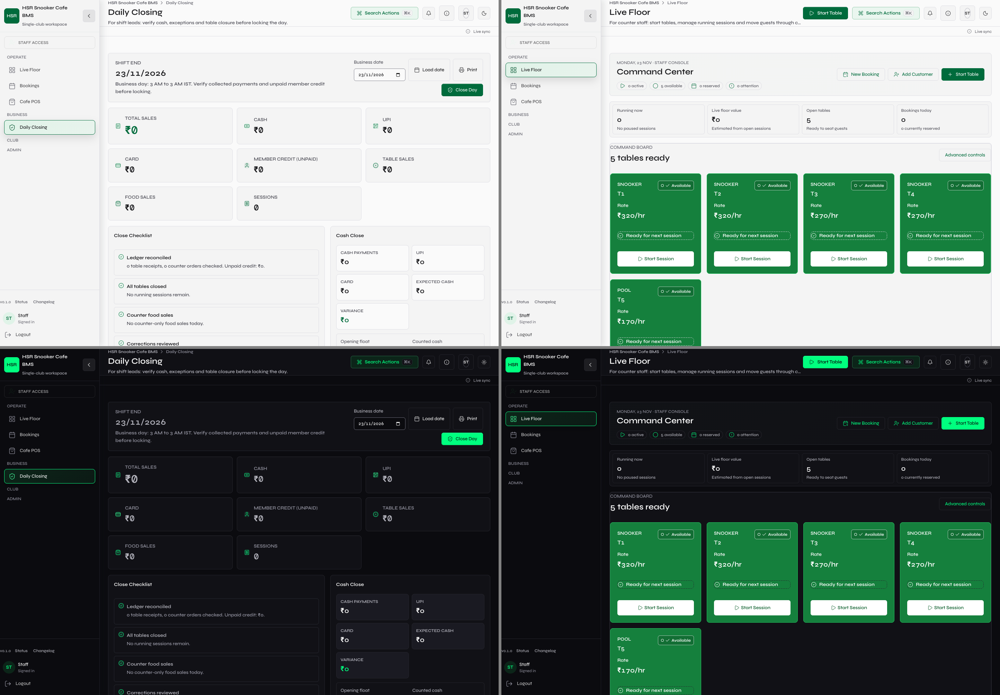
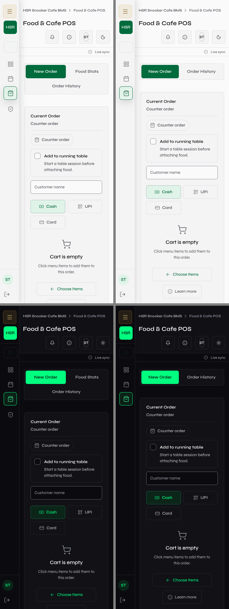
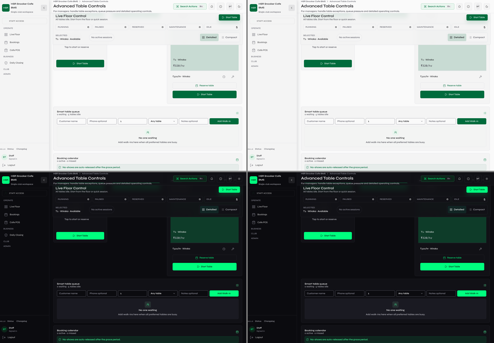

# Phase 3: Security and Access Review

Status on 23 November 2026: local hardening verified on
`codex/security-access-review`; **not merged or deployed**. Supabase project
inspection still needs the owner's specific project URL and read-only approval.
This is a review checkpoint, not a claim that every production security boundary
has been verified. No production business records or credentials were changed.

## Phase 2 Is Already Live

The owner explicitly confirmed the club was idle, a backup was ready, and immediate
deployment was approved. Backend stage `5e57d8c` was healthy with database readiness
and financial protocol 2 before publishing frontend merge `248390b`. All 35 served
JS/CSS/font hashes matched the tested build. Ten production login-screen checks
passed across both themes and five widths without submitting credentials or
mutating business records. Main's documentation receipt is `efd98b3`.
Evidence: [deployment](../phase-2/deployment.json),
[timeline](../phase-2/deployment-timeline.json), and
[production login checks](../phase-2/production-login/).

## Changes and Evidence

| Area | Released Baseline | Review Branch | Evidence |
| --- | --- | --- | --- |
| Owner/Staff data boundaries | Seven failed comparisons among 96 probes. Staff saw business summary fields, closing reports/insights, food statistics, table history/audit and closed-session events. | 96/96 pass. Staff summary contains only four operational counts; historical reports require Owner; table events are scoped to the current active session for Staff. | `access-before.json`, `access-after.json` |
| Staff interface | Daily Closing navigation/command/route, Food Stats and historical table controls were exposed. | Hidden and guarded, with no Staff food-statistics request. Owner controls retained. | `browser/before.json`, `browser/after.json` |
| Trusted Staff operations | Staff can run and close tables and correct session times. | Preserved, including checkout preview and normal floor/menu/booking/member lookup. | `postgres-final/security_access.log`, `access-after.json` |
| Body-size validation | Declared oversized body rejected, but a chunked body above the same limit returned 200 and reached the handler. | Both return 413; no note saved. A small chunked request still works. Stream responses are not buffered. | `body-limit-before.log`, `postgres-final/security_access.log` |
| Production CORS | Unrelated Vercel origins accepted; credentials enabled. | Exact configured origins only. Legacy `https://*.vercel.app` maps only to the canonical HSR site; other production wildcards are discarded. Bearer auth does not need cookie credentials. | Production-mode tests in `security_access.log` |
| Frontend headers | CSP/frame/referrer/nosniff restrictions absent in captured production response. | Enforcing CSP, exact bootstrap-script hash, self-hosted scripts/fonts, no framing, nosniff, no referrer and disabled unused device permissions. | `frontend-tests.log`, `browser/after.json`, `public-surface.json` |
| JavaScript dependencies | Three High-rated packages in the saved audit. | Zero known advisories: Vite 8.3.8, follow-redirects 1.16.3, zod 4.6.7. | `npm-audit.json`, `npm-audit-after.json` |
| Python dependencies | Eleven advisory records across four packages, including duplicate advisory IDs. No patched python-jose/ecdsa releases in that snapshot. | Replace the unused asymmetric-JWT dependency chain with PyJWT 2.15.1 for the existing HS256 protocol; update build tools. Zero known advisories across 34 installed packages and 12 separately inventoried bundled build-tool packages. | `python-audit-before.json`, `python-audit.json`, `python-bundled-audit.json`, corresponding package inventories |
| QA log hygiene | Six historical JWT findings, all expired/test-context tokens; 26 token-shaped strings in current copies of six logs. | Current copies redacted; future httpx test diagnostics filtered. Six exact historical fingerprints reviewed, not a blanket logs/JWT exclusion. History is not rewritten. | `secrets-history.json`, `qa-log-redaction.json`, `.gitleaksignore`, `secrets-history-after.json` |
| Design preservation | Approved SNOOK colors and Syne + DM Mono. | All 13 built CSS/font files byte-identical to the verified Phase 2 release. | `appearance-assets.json` |

Before is the archived released source `248390b`, run with disposable local data;
after is the built review source with the proposed CSP enforced. It is not a
production mutation test. Browser contexts block all non-read API requests after
local QA login. Checks cover Owner/Staff, light/dark, 375/1440px: eight contexts,
three pages each, 24 screenshots per stage. No horizontal overflow, page errors,
CSP violations or attempted business writes in the final run.

Comparison images are original pixels: **before left, after right; light above,
dark below**. Permission removal changes Staff navigation, not the brand/layout.





All six mobile/desktop comparisons and input image hashes are listed in
[`browser/comparisons.json`](browser/comparisons.json). Screenshots wait for loaded
content and fonts, rather than comparing a skeleton with a settled screen.

## Verification

- Fresh Python 3.11.9 install, production-shaped configuration, disposable
  PostgreSQL 16: **159 test executions passed**, production app import passed,
  short soak cycle passed. This is a regression cycle, not a long-duration soak.
  Exact commands, timings and logs: [`postgres-final/results.json`](postgres-final/results.json).
- Eighteen security-specific tests also pass on disposable SQLite. Existing
  credential rotation, token revocation, default-password rejection, validation,
  spoofed-forwarded-header login limiting and anonymous-route tests reran inside
  the full PostgreSQL suite.
- JWT compatibility explicitly covers independently encoded legacy HS256 login
  tokens, logout revocation, legacy checkout quotes and idempotent repeat checkout;
  unexpected HS512 headers and signed tokens without expiry are rejected. No
  signing secret, 24-hour lifetime or token-version contract was changed.
- Frontend lint/build, eight financial-intent tests, sixteen request-recovery
  tests and four browser-policy tests pass. CSP allows required inline **styles**
  for the existing UI, not arbitrary inline scripts or eval. The local preview
  changes only the allowed backend origin from Render to loopback.
- Full strict contrast scan: **21 routes, both themes, zero violations and zero
  errors**, including large text and disabled controls at the 4.5:1 minimum.
  The actual arrays are retained in `contrast.json`.
- Official checksum-verified Gitleaks 8.30.1 scans all history reachable from valid
  local refs. Only location metadata is saved. Existing malformed refs are skipped
  and left untouched; unreachable/reflog-only objects and absent remote refs are
  outside that scope. A scan is not proof that credentials were never exposed.
- `secret-scan.yml` adds the same history guard to pull requests and main/codex
  pushes. Backend parity adds the security tests and fresh build-tool installation;
  frontend parity checks CSP hashes against both source and built HTML.

Repeat locally with disposable data only:

```sh
cd backend
python test_security_access.py
python audit_access_boundaries.py --output ../docs/daily-use-readiness/phase-3/access-after.json
```

The test fixture rejects non-loopback database URLs before importing the app.
With no explicit test URL it creates disposable SQLite, not the application DB.

## Remaining Risks and Decisions

1. **Supabase not verified:** actual RLS/policies, exposed schemas, grants, Data API
   settings, database-role privileges/BYPASSRLS, pooler TLS and production secret
   strength/rotation history. The browser approval gate denied private-dashboard
   access without explicit project authorization. No alternate access path was
   attempted. Supply the project dashboard URL and read-only authorization before
   completing this part. Available local configuration is SQLite, not proof of
   production settings. No secret values were printed.
2. Authenticated identities remain shared Owner (`admin`) and Staff. Manager,
   Cashier and Waiter settings rows do not implement real permissions or individual
   employee identities. That requires a separate design, not misleading UI claims.
3. Tokens still expire after 24 hours without silent refresh. Counter tablets need
   a new login then; no token extension or refresh scheme is hidden in this change.
4. Login protection is account-wide, in-process: five failures within a 15-minute
   window, then 429. `Retry-After` says ten minutes, while actual eligibility follows
   the rolling failure window. Restart/workers reset or split this state; many
   distinct guessed usernames are not bounded by one global limit. Other sensitive
   writes rely on role checks/validation but have no independent rate limit or
   password reauthentication. Persistent/global throttling and step-up confirmation
   need an explicit policy, especially with shared accounts. The existing spoofed
   IP-header bypass regression passes; it does not prove distributed protection.
5. Dependency scans are time-bound advisory checks, not penetration tests. No
   demonstrated production exploit is inferred merely from a package rating.
   Exact installed versions are inventoried; requirements still use the project's
   compatible version ranges rather than a fully locked Python environment.
6. CSP currently permits only the canonical Render backend. New approved backend
   or image hosts need an explicit policy update and regression, not a wildcard.
7. New RLS, schema, roles, production credentials and rate-limit architecture have
   not been deployed. Render free-tier cold starts and the single-worker SSE broker
   limitation remain as documented; no SSE expansion occurred.

Supabase's server-side API guidance:
[API exposure/grants](https://supabase.com/docs/guides/api/securing-your-api),
[RLS and bypass roles](https://supabase.com/docs/guides/database/postgres/row-level-security).
PyJWT's [verification API](https://pyjwt.readthedocs.io/en/stable/api.html)
documents fixed allowed algorithms and required claims used here.

**Next approval:** authorize the specific Supabase project read-only inspection,
then review this checkpoint and decide whether to merge/deploy Phase 3. Phase 4
backup/monitoring does not begin automatically. No destructive migration, account
creation, key rotation or production business mutation was performed.
