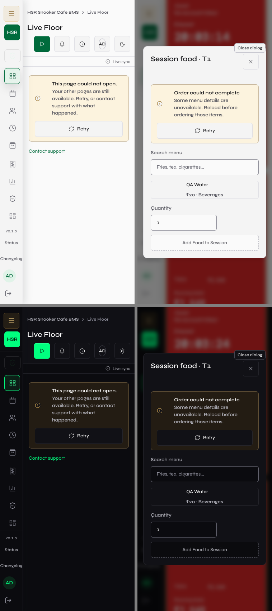
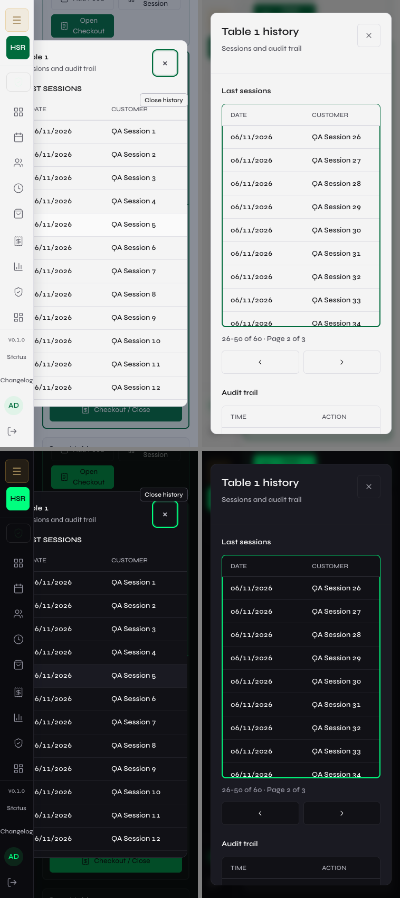

# Final UI Completion

This closes the outstanding engineering work from the deployment-readiness
pass. Baseline: `c7a294b`. Product changes are frontend-only; billing rules,
backend authorization, trusted Staff time editing and the approved palette/fonts
are preserved. SSE expansion is not part of this release.

## Changes And Visual Evidence

Before is left, after is right; light above dark. Comparison sheets contain
original screenshot pixels, with the first 1,000px of tall captures.

| Page | Fault | Rule | Fix Applied | Before/After |
| --- | --- | --- | --- | --- |
| Dashboard | Manage tables ended at x=406.92 in a 375px viewport | Actions remain reachable | Wrapped floor heading/actions; final control clipping is zero | [Dashboard](../comparisons/final-dashboard-default-375.png) |
| Regular Customers | All Time ended at x=447.42 on mobile | Filters fit their container | Wrap periods below the heading when needed | [Filters](../comparisons/final-report-filters-default-375.png) |
| Cafe reports | Dense data widened the grid; Manage Menu ended at x=781 | Data cannot push controls offscreen | Shrinkable grid tracks/children and wrapping tabs | [Stats](../comparisons/final-cafe-stats-extreme-375.png), [History](../comparisons/final-cafe-history-partial-375.png) |
| Session food | Null menu entries crashed; an empty menu lacked an action | Unknown is not free/in stock | Validate menu shapes, retain valid items, show Retry and a shared 32px-icon empty state | [Partial](../comparisons/final-food-partial-375.png), [Empty](../comparisons/final-food-empty-375.png) |
| Session food / Reset | Pending requests could lose their dialog/input | Feedback and retained work | Shared pending controls and dismissal locks; failed requests retain values | [Reset](../comparisons/final-reset-reset-375.png), `session-food/after-final/` |
| Table history | Failed reads looked empty; unbounded rows and overflow | Truthful, bounded data | Per-resource Retry; neutral missing values; 25-row paging; keyboard-scrollable regions with sticky headers | [Failure](../comparisons/final-history-history-error-375.png), [Populated](../comparisons/final-history-history-populated-375.png) |
| Command palette | Private dialog frame; repeated shortcut could leave a loader | Shared focus/keyboard behavior | Shared Modal, correct nested-dialog guard, active-row scrolling and repeated-shortcut handling | [Commands](../comparisons/final-command-commands-375.png) |
| Session details | Private money/list panels and non-roving tabs | Shared components | Card/Panel roots and shared keyboard tabs; shared idle state | `session-widget/before-final/`, `session-widget/after-final/` |
| Sidebar | Footer text clipped in a compact rail; utility links left mobile navigation open | Bounded navigation | Existing collapsed-footer behavior on mobile; shared navigation callback closes the rail | [Sidebar](../comparisons/final-sidebar-compact-375.png) |
| Shared styles | Repeated literal paints/spacing and missing icon aliases | Stable tokens/components | 200 exact existing paints consolidated; 4px spacing grid; missing Lucide aliases restored | `token-migration.json`, `token-contract.json` |

Two unreachable legacy checkout screens were removed after confirming that the
only app consumer already routes checkout to Live Floor. The active checkout
and server-confirmed settlement behavior are unchanged.

## Verification

- `release-matrix-final/results.json`: all eight matrix groups pass, comprising
  1,392 observations. Applicable states are tested at 375/768/1024/1440px in
  both themes; static pages and informational Billing retain applicable states.
- `lifecycle-final/results.json`: 20 real local browser workflows, including
  Cash/UPI/Credit and exactly one persisted transaction per session. Guest names
  create no member rows. These are not API-only repetitions.
- `session-food/after-final/results.json`: 40 Owner/Staff cases cover loading,
  empty, malformed, partial and pending/error behavior without forwarded writes.
- `session-widget/after-final/results.json`: 16 frame/idle cases, including
  keyboard tabs and a browser-mocked failed frame request.
- `closure-20261118/`: fresh final-page, contrast, menu, dialog, navigation and
  source-contract results. This is the closure record for the earlier timeouts.
  All nine suite steps pass: 160 loaded-page samples, 16 menu/confirmation cases
  (48 menu checks), 16 remaining-dialog cases, five navigation retries, strict
  21-route contrast with zero violations/errors, lint, theme and token checks.
- `closure-20261118/member-feedback/results.json`: all 16 isolated cases pass;
  visible pressed state and the search field appear in 27.2-30.3ms. The earlier
  concurrent timing outlier remains under `member-feedback-parallel-probe/`.
- Palette proof preserves all 437 existing token definitions and both fonts;
  the 200 migrated paint values match exactly. No brand change is implied.

Button feedback is not a business-success claim. The broad page audit observed
2,151 controls across 84 route/theme/width configurations: 2,054 passed initially,
84 were disabled and 13 required follow-up. The separate shell audit observed
219 controls, including five unresolved timed-out interactions. Those original
reports remain intact. Follow-up results and disabled exclusions are explicit.
The audit tool now fails for an unreachable setup state as well as a failed
button, preventing a missing setup from silently producing a green result.
The five final navigation retries have zero unreachable states or exclusions;
all five pass, with press feedback in 32.3-33.3ms. These close the recorded
shell exceptions without claiming that blocked mutations succeeded.

## Diagnostic History And Scope

Earlier failed/interrupted reports are not final acceptance. They include a
baseline Chrome launch timeout, screenshot/navigation timeouts, an incorrectly
authenticated Login harness, an unauthorized extra local CORS origin, and the
history overflow/scroll probes. Login has its dedicated unauthenticated contract.
The first member-feedback run has one 380.8ms timing outlier during concurrent
browser/image work; its report is retained separately from the isolated rerun.

The original page-button retry had an unreachable Search LP Member setup; it is
not treated as a pass. The final dedicated member-feedback test covers that
action directly on `/` and `/live-floor`, for both roles/themes and two widths.

GitHub includes full result reports, the matched comparison sheets and selected
raw final/baseline screenshots. Duplicate intermediate PNGs and the remaining
full-resolution matrix captures are retained locally, but excluded from Git by
the scoped `.gitignore`. `comparisons.json` records source paths and source-image
SHA256 hashes for every sheet; full tall source captures are not reconstructed.

Production mutations are not performed. Desktop Chrome viewport emulation does
not certify physical iOS/Android devices, OS-native select behavior or an
unfamiliar person's full-day operation. Those remain external pilot acceptance.
Free-tier first-load delays and paused SSE soak work are not declared solved by
this UI release. Deployment and disposable-data cleanup evidence is recorded below.

`closure-20261118/cleanup.json` independently verifies zero business rows in the
disposable QA database. Four schema-migration markers were not business data;
the entire disposable database was then discarded. Both owned QA servers exited.
The user's original checkout/server and production business records were untouched.

## Deployment

Source `38d30f5` and evidence through `9f3af6b` are fast-forward merged into main
and acknowledged by GitHub. The [refreshed production proof](../deployment-final-completion.json)
matches all 24 JS/CSS SHA256 hashes and verifies health 200, database readiness
200 and backend-fix ancestry. The backend remains at `e014ff4`, as expected for
this frontend-only release. The [initial proof](../deployment-final-completion-initial.json)
is retained, including the first timeout followed by a complete successful check.
The refreshed observation also records an initial timeout before success; no
timeout is treated as readiness evidence.

`closure-20261118/production-login/results.json` also passes both live Login
themes: visible form controls, zero JavaScript errors, no broken images and no
horizontal overflow. No credentials were entered/submitted; all write methods
were blocked. Production business workflows were not mutated by this smoke check.

An upload connection stalled after GitHub had accepted its commit. Delivery
resumed from the directly observed remote revision with bounded network waits,
without force-pushing, dropping accepted commits or rewriting published history.

## Matched Screenshots

The [comparison manifest](comparisons.json) links all 30 sheets, including every
main page, with the source-image hashes and full capture paths.
