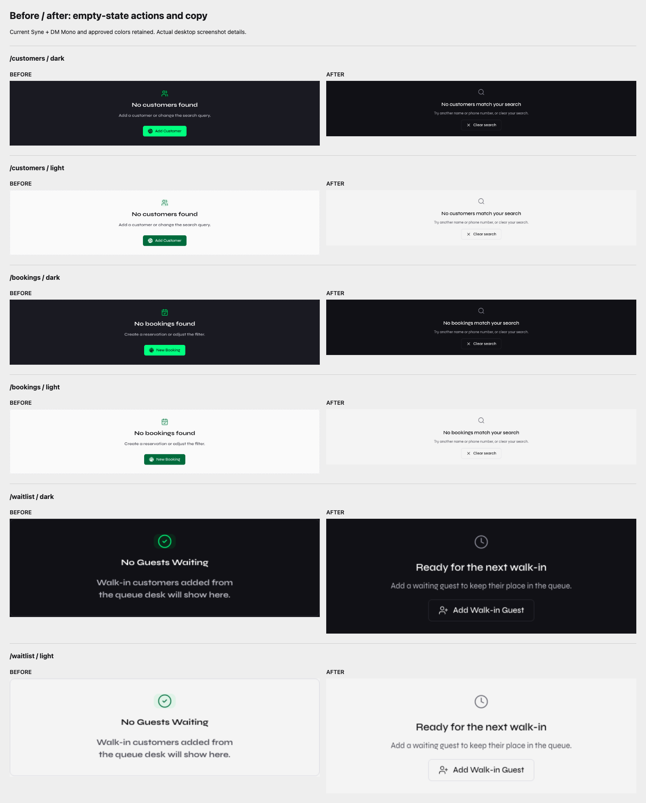

# Empty-state polish - 2026-10-12

The user chose to keep Syne + DM Mono after the Inter comparison. This
presentation-only follow-up does not change theme tokens, backend endpoints,
billing, saved records or SSE subscriptions. SSE rollout remains paused.

## Changes and evidence

| Page | Fault | Rule | Fix applied | Before/after |
| --- | --- | --- | --- | --- |
| Customers | An unmatched search offered Add Customer, indistinguishable from an empty register | Explain the actual state; provide the relevant next action | Separate first-customer and no-match copy; Clear search restores existing profiles; Add Customer focuses the existing form | [Matched screenshots](index.html), both themes and 1440/375/414px |
| Bookings | Search/status filters said No bookings found and offered another booking | Distinguish no records from a filtered view | Clear search restores rows; Show all bookings clears the status filter; the empty register opens the existing booking form | [Matched screenshots](index.html), both themes and 1440/375/414px |
| Waitlist / shared workspace registers | Local empty-state implementation; no action beside the empty walk-in queue | One reusable treatment; action beside the affected content | Shared EmptyState, neutral icon and unframed content; Add Walk-in Guest opens the existing form; toolbar remains the primary action | [Matched screenshots](index.html), both themes and 1440/375/414px |

The neutral secondary empty-state buttons do not add another competing primary
action to each page. Icons, headings and descriptions use existing tokens;
the seven-size scale and the approved table-state borders/fills remain intact.
Other shared workspace register empty states inherit the reusable component;
their underlying data/actions are unchanged.

## Verification

- Before: 30 matched browser samples. After: 36 samples, including the additional
  booking status-filter scenario. [Before measurements](before/measurements.json)
  and [after measurements](after/measurements.json).
- All 36 action checks passed. Actual click-event to visible DOM/focus response:
  **1.5-112.4ms**. These measurements exclude automation's scroll and click
  preparation. Search resets restore a real fixture row; status reset selects
  All and restores a booking; existing forms open and close with Escape.
- Minimum measured mobile action height: **44px**; zero horizontal overflow at
  **375px / 414px**, both themes.
- Full-route regression: **66 samples**, zero page errors, off-scale visible
  text, unshared controls or horizontal overflow. Meta-K, Ctrl-K, arrows/Enter
  and Escape passed in both themes. [Measurements](routes/measurements.json).
- Actual computed body font remains `"Syne Variable", Syne, sans-serif`.
  Dark canvas/accent: `#0B0B0F` / `#00FF7F`. Light canvas/accent:
  `#FAFAFA` / `#006B3C`. Theme token declarations and DM Mono imports are unchanged.
- Lint, theme guard and production build passed. Existing realtime-manager
  regression passed: maximum one stream, forced-503 fallback, final subscribers 0.
- Contrast scanner: **0 violations, 0 errors**, including loaded routes,
  login error, notification popover, command palette and first safe action.
  [Actual output](contrast.json).
- Merged and pushed source commit `dc328ea`. [Deployment proof](deployment.json)
  verifies all **21 production JS/CSS assets** against the local build SHA256,
  including `index-Ddyr75EL.js`. Backend health/readiness returned 200, and
  unchanged revision `4d8a0b2` contains the required prior backend fix by ancestry.
- [Anonymous production browser checks](production/measurements.json): both
  themes at 1440/375/414px, Syne actually loaded, original canvas colors,
  44px mobile actions, preserved icon/placeholder spacing, zero contrast
  violations/page errors/overflow. No credential entry or production mutation.

## Safety and scope

The added fixtures exist only in intercepted local browser responses. No QA
business records were created, no production account was used, and no business
write was issued. The test blocks writes and asserts the attempted count is zero.
Local forced SSE 503 isolates presentation from realtime updates; it does not
stand in for a fresh cross-device SSE rollout test.

This closes the Customers/Bookings/Waitlist empty-state cluster, not the entire
presentation brief. Cafe POS and Analytics still have page-local empty-state
renderers to consolidate separately. Historical KPI deltas, arbitrary avatar
hues, new onboarding, a new command system, and brand/layout changes are not
silently added. No claim is made that every populated-row or error state has
been tested, or that an overflow assertion detects every possible overlap.

## Reproduce

Use only a disposable local backend/database and local frontend. Set
`POLISH_APP_URL` and `POLISH_API_URL`, then run `npm run test:empty-states`.
`EMPTY_STAGE=before` records the baseline without asserting new controls.
`node scripts/compose-empty-state-evidence.mjs` assembles existing screenshot
pixels into the gallery/comparison. `POLISH_OUTPUT_DIR` directs the existing
full-route regression into a new evidence folder, preserving earlier captures.
