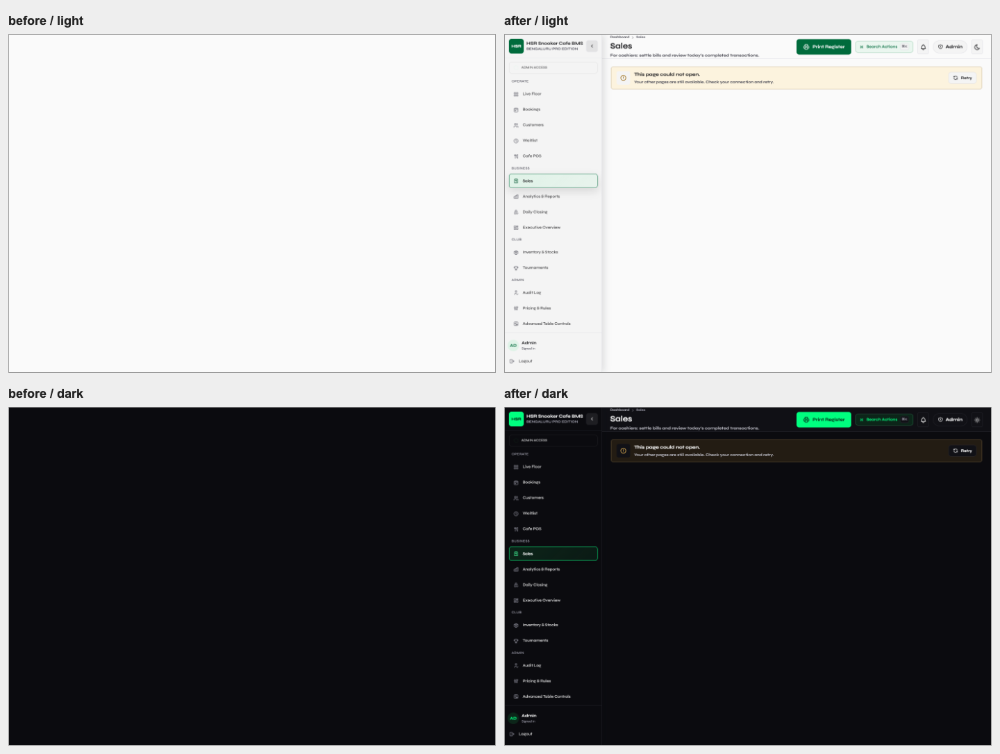

# Full-stack integrity audit

Date: 2026-10-11 IST. Baseline: `226a51d` on main. Branch: `codex/full-stack-integrity-audit`.

**Shipped and verified:** main `7d3dc79` is live on Render, `/health` and
`/ready` return 200/database ok; all 22 production JavaScript/CSS assets match
the tested build by SHA-256. Full runtime/asset/ancestry receipt: `deployment.json`.
Final branch parity also passed [run 38081454846](https://github.com/KingShivesh/hsr-bms/actions/runs/38081454846).

## 1. Executive summary

27 grouped findings: **0 confirmed Critical, 9 High, 14 Medium, 4 Low**. All nine High findings are fixed and regression-verified. One Medium password-validation defect was fixed with the same authentication boundary; the other 13 Medium and four Low findings are deferred below. Absence of a confirmed Critical finding is not a security certification.

Top five urgent issues were surviving tokens after credential rotation/logout, client-forged order undo, backdated checkout, lost concurrent session food writes, and staff access to the admin dashboard API. Seeded-password acceptance, spoofable login throttling, blank-screen route failure, and vulnerable JavaScript dependencies were also fixed.

Estimated remediation effort: High, roughly 1-2 engineering days including regression/deployment checks, completed in this pass; remaining Medium, 4-8 days in small reviewed batches; Low, 1-3 days depending on upstream dependency fixes. These are planning estimates, not commitments.

**Preserved:** SNOOK palette, Syne/DM Mono fonts, existing navigation/layout, billing tariffs and payer allocation. No new product feature, tenant model, payment gateway, or SSE rollout was added. Production was not mutated during the audit.

**Release consequence:** pre-release JWTs intentionally require a fresh login. Production will reject seeded `admin123`/`staff123` passwords; an admin with a rotated credential must rotate any still-default staff account through Settings. This audit did not try those passwords against production or establish whether either is currently in use.

## 2. Findings table

References below point to the fixed source location or retained defective source. Before-fix behavior is reproduced from the unchanged baseline in the linked logs, not inferred from the patch.

| ID | Severity | Layer / file:line | Reproduction and impact | Resolution |
| --- | --- | --- | --- | --- |
| F-001 | High | Auth, `backend/deps.py:59`, `backend/routers/auth.py:158` | Admin/staff credential rotation left old bearer tokens valid: `/auth/me` 200. Logout had no server endpoint, 404. A copied token retained access for 24h. | Role credential versions plus token-ID digest revocation; existing streams recheck authority. Fixed. |
| F-002 | High | Orders, `backend/routers/food.py:114` | Staff restored nonexistent order 900000 with client total 900000: 200 and invented sale. Undo of a real 40-rupee receipt accepted 999999 and a changed customer/payment method. | Soft-cancel original server receipt, lock on undo, reject missing ID, ignore client receipt amounts; filter cancelled rows everywhere; audit actor. Fixed. |
| F-003 | High | Reports, `backend/routers/reports.py:211` | Frontend Dashboard was admin-only, but staff could request `/reports/dashboard`: 200 with business totals. | Backend `require_admin`; staff now 403. Fixed. |
| F-004 | High | Billing, `backend/routers/sessions.py:499` | Four-hour session closed using client timestamp at start+1min: receipt billed 1min/5 rupees. | Server quote freezes timestamp using session-bound HS256 token, 10min expiry; forged/backdated timestamp 409. Current and legacy checkout consumers pass token. Fixed. |
| F-005 | High | DB/billing, `backend/database.py:169`, `backend/routers/sessions.py:1359` | Actual local PostgreSQL: two simultaneous 20-rupee additions both returned 200, final receipt retained only 20/one line. | Transaction gate before reads including vacant slots, row locks for active sessions, same gate for bookings, no early audit-control commit. Both lines and 40 retained. Fixed. |
| F-006 | High | Frontend, `frontend/src/App.jsx:405`, `frontend/src/components/RouteErrorBoundary.jsx:1` | Forced 503 on lazy Sales route module erased the entire app body in both themes. | Route boundary preserves shell/nav with existing RetryNotice; restoring network then actually clicking Retry loads Sales. Fixed. |
| F-007 | High | Auth, `backend/routers/auth.py:48` | Six wrong passwords with different spoofed `X-Forwarded-For` values returned six 401s, avoiding the 5-attempt lock. | Account-wide bucket, expired bucket cleanup; sixth attempt 429 regardless of header. Fixed for documented single-worker deployment. |
| F-008 | High | Auth, `backend/routers/auth.py:120` | Isolated `APP_ENV=production` test accepted seeded staff password, 200. Not tested on live credentials. | Production rejects both seeded passwords; credential update cannot set either in production. Local development seeds remain usable. Fixed. |
| F-009 | High | Dependencies, `frontend/package-lock.json:1`, `render.yaml:8` | `npm audit`: 11 affected packages, 8 High/2 Moderate/1 Low; fresh installer scan also found fixed pip advisories. Counts include transitive/dev tools, not 11 demonstrated production exploits. | Compatible lockfile updates, no app framework switch; npm audit now zero. Fresh/deploy/CI pip upgraded. Two inactive Python advisory families remain F-026. Fixed. |
| F-010 | Medium | Auth, `backend/routers/auth.py:40` | An eight-character padded password passed validation then was trimmed before storage; UTF-8 passwords over bcrypt's 72-byte limit failed inconsistently. | Validate the stored value, reject short non-padding content and >72 UTF-8 bytes; preserve exact accepted password. Fixed as part of authentication repair. |
| F-011 | Medium | CORS, `backend/main.py:32` | Read-only production preflight accepted unrelated `https://audit-untrusted.vercel.app`, credentials=true. Bearer auth still required; not an unauthenticated bypass. | Defer: owner-approved exact production/preview origin allowlist. |
| F-012 | Medium | Hosting, `frontend/vercel.json:1` | Live HTML has HSTS but no CSP, frame restriction, nosniff or Referrer-Policy. Backend does set these separately. | Defer: tested frontend security headers and staged CSP; avoid breaking fonts/assets. |
| F-013 | Medium | Accessibility, `frontend/src/components/tabs/TablesTab.jsx:220`, `SettingsTab.jsx:219`, `OperationsTab.jsx:205`, `TournamentTab.jsx:295`, `ClubSuiteTab.jsx:1043` | 34 route/theme axe runs: 16 rule occurrences, five routes; `label`, `select-name`, `nested-interactive`. Exact nodes in browser.json. | Defer: associate existing labels, name selectors, remove nested interactive card semantics; keyboard rerun. Axe's "critical" label-impact category is not this report's security Critical tier. |
| F-014 | Medium | Query performance, `backend/routers/waitlist.py:47` | 100 queue rows: 203 SQL queries, 180.05ms locally. `_format_entry` repeats two floor-state reads per entry. | Defer: fetch floor availability once per list and format against snapshot. |
| F-015 | Medium | Reports, `backend/routers/reports.py:220`, `frontend/src/features/sales/SalesPage.jsx:79` | Synthetic 5,000 receipts: history 2,472,894 bytes/479.6ms, closing report 2,473,770 bytes/479.33ms. Lists fetch all rows and render without paging. | Defer: server filtering/pagination; bound rendered rows before considering virtualization. |
| F-016 | Medium | Schema, `backend/models.py:99`, `backend/models.py:262` | PostgreSQL inspection: all 22 tables have PKs, zero explicit FKs and zero CHECK constraints. Frame/tournament ownership and enum/amount rules exist only in application code. | Defer: validate real data first, staged FK/CHECK migrations with explicit delete behavior. Do not add cascades blindly to financial history. |
| F-017 | Medium | Schema/time, `backend/models.py:43`, `backend/models.py:187` | Epoch Float and IST string timestamps, no consistent created/updated contract; JSON stored as Text with scattered parsers. Not a demonstrated timezone misbill. | Defer: explicit timestamp/JSON schema contract and backfill plan; preserve nullable pricing snapshots used for legacy open sessions. |
| F-018 | Medium | Migrations, `backend/database.py:32`, `backend/main.py:29` | Startup additive DDL is idempotent (run twice verified) but has no version ledger/down migration; startup runs create_all. | Defer: versioned migrations, predeploy step, backward-compatible rollout and tested rollback. |
| F-019 | Medium | Realtime, `frontend/src/realtime/connectionManager.js:37` | Stream reader waits indefinitely if a connection stays open but sends no data. Initial connection grace exists, no post-connect missed-heartbeat watchdog. Safety REST polling limits impact. | Defer: bounded idle watchdog test, abort/resync/backoff; no SSE batch expansion. |
| F-020 | Medium | Auth/shift, `backend/deps.py:18` | JWT expires after 24h; no refresh endpoint/client mechanism. Staff must log in again, including SSE expiry. | Defer: documented backlog already exists; separately scoped refresh/session lifecycle, not silently added here. |
| F-021 | Medium | Testing, `backend/routers/events.py:44`, `backend/routers/settings.py:1` | Instrumented 40 regression tests + one soak cycle: overall 68.81%; six modules remain <50%. Live HTTP/SSE browser evidence is not included in Python coverage. | Defer: prioritize SSE, Settings, operations, tournament, staff and challenge failure paths. |
| F-022 | Medium | Feedback, `frontend/src/components/tabs/SettingsTab.jsx:117`, `SettingsTab.jsx:367` | Credential/rate handlers await requests with no local saving state; buttons remain enabled until toast/reload. Critical table actions do have measured immediate feedback. | Defer: common async guard for Settings writes, preserve input; click test under 350ms injected latency. Not claimed as a tested whole-app button inventory. |
| F-023 | Medium | Deployment, `backend/requirements.txt:1` | Most requirements use only lower bounds. Fresh parity resolved materially newer runtime versions than the long-lived local venv; installer success alone is not repeatability. | Defer: reviewed pinned/locked dependency set, scheduled tested updates. Current clean parity gate passed. |
| F-024 | Low | Readability, `frontend/src/style.css:420`, `frontend/src/components/ui/Checkbox.jsx:11` | Scanner reports six duplicated occurrences (three unique pairs) in disabled Cafe POS checkbox captions: 3.51/2.37 light, 3.29 dark. Native input is disabled, captions fade via ancestor opacity .52. | Defer: keep explanation readable using existing semantic tokens, reduce only control chrome. Associated disabled-control text is WCAG-exempt; scanner flags remain visible rather than being silently discarded. |
| F-025 | Low | Observability, `backend/main.py:64` | Request ID/status/duration and exceptions are logged, but logs are plain text; no configured error tracker, persistent latency histogram or alerts in deployment config. | Defer: structured redacted logging and owner-configured alerts; do not log tokens/passwords/PII payload snapshots. |
| F-026 | Low | Python dependencies, `backend/deps.py:17` | pip-audit retains ecdsa Minerva signing and python-jose DER/asymmetric-key confusion advisories with no published fixes. Three records represent two unique advisories. | Current app uses fixed HS256 with symmetric secret, not ECDSA signing or DER public keys. Inactive attack paths, not a clean dependency scan. Track upstream replacement/update before any asymmetric JWT work. |
| F-027 | Low | Payload, `frontend/src/style.css:1` | Built CSS 626.72KB/88.06KB gzip, including overlapping legacy rules and bundled frameworks. Largest page chunk Tables 63.16KB/15.98KB gzip; route code splitting works. | Defer: measured unused-style removal with screenshot tests, not a cosmetic rewrite. |

## 3. Fixes applied and verification

Backend/security commit `aa8b5cf`; matching frontend/dependency commit `777390a`.

| Evidence | Result |
| --- | --- |
| `baseline-tests.log`, `auth-hardening-before.log`, `postgres-race-before.log` | Unchanged baseline failures reproduced before fixes; isolated test data only. |
| `postgres-security-after.log` | 16/16 pass, real local PostgreSQL. Includes rotation, logout, forged undo, signed quote, spoofed throttling, default-password guard, booking conflict and all 95 non-public OpenAPI operations returning 401 without auth. |
| `postgres-session-after.log` | 24/24 pass; concurrency, pause/resume, start identity, peak snapshot, frame/package, split payment, transfer, schema upgrade and duplicate checkout. |
| `sqlite-security-after.log`, `sqlite-session-after.log` | 16 and 24 tests run; one PostgreSQL-only concurrency test skipped in each SQLite suite. |
| `postgres-soak-after.log` | Production-mode local PostgreSQL: 61.3s, 33 cycles, 2,199 requests, 99 session closes and ledger checks, zero failures/active sessions left; avg 20.9ms, P95 47.5ms. Not a 30-minute memory soak. |
| `actions/measurements.json` | Browser start/order/pause/resume/checkout/booking/frame guards pass; actual disabled/loading feedback 4.4-13.8ms with injected delay; both themes and 375/414px actions unobscured/minimum 44px. |
| `sse-revocation.json` | Raw local HTTP: connected, two heartbeats, logout 200, old token REST 401, existing stream auth_expired at 30,052.7ms. No connection holds a DB session for its lifetime. |
| `after/browser.json` | 17 routes x light/dark; zero uncaught errors in normal navigation, 16 mobile route/theme/width checks with zero horizontal overflow. Full screenshots before/after retained. |
| `route-recovery.json` | Forced route-module 503: shell survives in both themes; actual Retry click after removing failure recovers Sales. |
| `logout-browser.json` | Actual Logout clicks in both themes: forced503 shows visible error and preserves session; retry reaches login and old token returns401. |
| `npm-before.json`, `npm-after.json`, `pip-fresh.json`, `pip-after.json` | npm 11 affected packages -> 0; installer updated; residual Python advisories explicitly retained F-026. |
| `database.json` | 10 EXPLAIN ANALYZE plans from observed SELECTs in the synthetic local workload; schema/index/nullability inventory; nine integrity queries all zero. Not production counts or production's ten slowest queries. |
| `coverage.json` | 68.81% application statement coverage; sessions 65.77%; low coverage modules listed below. |
| `performance.json` | Lighthouse desktop/local production build: Dashboard score97/LCP1,802ms/TBT38.75ms; Live Floor99/1,803ms/55ms; Sales100/1,429ms/25.89ms. CLS0 all three. INP/FID not measured by navigation Lighthouse; these are not real-user or Render cold-start numbers. |
| `source-colors.json` | 145 matching source lines with file/line/value; zero literal color utilities, `dark:` utilities or JSX hex literals found. Token definitions and CSS status/legacy rules retained, not blindly rewritten. |

Frontend lint, production build, theme guardrail, shared realtime-manager regression and backend syntax checks pass. The clean Python3.11.9/PostgreSQL16 gate passed [run 38080979260](https://github.com/KingShivesh/hsr-bms/actions/runs/38080979260).

The rendered contrast scan is **not reported as zero**: six disabled-label occurrences remain (F-024). The critical table-action/browser states separately passed their scanner assertions. Accessibility is also not claimed clean: exact axe targets remain in `after/browser.json`.

### Visual failure/recovery, both themes

Left: baseline blank app after failed module load. Right: repaired shell, route-specific retry. Top light, bottom dark.

Every route's original and current pixels are in `before/` and `after/`, including Dashboard, Live Floor, Inventory, Analytics, login and all supporting pages. Before uses unchanged application code; both sets use the same disposable QA backend and viewport, not production business data.

## 4. Deferred tickets

Ticket IDs are the findings above; no new feature work is implied.

| Queue | IDs | Acceptance condition |
| --- | --- | --- |
| Security/config | F-011, F-012, F-023 | Explicit origin rejects unrelated preview; frontend header/CSP browser tests; repeatable fresh pinned install. |
| Accessible controls | F-013, F-022, F-024 | Named inputs/no nested controls on five routes; Settings feedback <=200ms and no double writes; captions readable in both themes without changing palette. |
| Data scale | F-014, F-015 | Queue SQL count independent of row count; paginated history/closing detail with bounded response size and UI rows. |
| Schema safety | F-016, F-017, F-018 | Production preflight orphan/duplicate counts reviewed; explicit ownership/delete behavior and timestamp contracts; repeatable up/rollback rehearsal. |
| Long shifts/realtime | F-019, F-020 | Open-but-silent stream recovers; refresh/expiry design tested separately; single-worker limitation retained. |
| Coverage/operations | F-021, F-025 | Raise key failure-path coverage; redacted structured logs, basic alerts and request latency visibility. |
| Dependency/payload upkeep | F-026, F-027 | Upstream advisory resolution or vetted JWT replacement; measured CSS reduction with screenshot regression. |

Current low-coverage modules: events20.3%, tournaments28.7%, staff40.0%, operations42.0%, challenges46.4%, settings48.1%. This percentage covers the instrumented Python suites and one soak cycle, not the browser/raw-stream runs.

## 5. Scope, recommendations and unverified gates

- Database is **SQLite locally, Supabase PostgreSQL in production**; FastAPI backend on Render and React/Vite frontend on Vercel. This remains a **single venue**, explicitly documented in PROJECT_CONTEXT, not a shipped multi-tenant SaaS. No fictional cross-tenant leak is counted. Tenant membership/resource scoping is a mandatory gate before onboarding another club, not silently built in this audit.
- Existing REST auth covers the protected domains; role restrictions for members/config/reports are enforced server-side. Dashboard mismatch was the confirmed leak fixed here. SSE is metadata-only with topic role filtering, replay/resync, jittered retry and fallback/safety polls; no money/customer payload was added. One shared stream per tab test: max1, final subscribers0, forced503 fallback true.
- Parser-time theme bootstrap precedes React, `html.dark` controls semantic tokens and native color-scheme follows it. Login uses the same theme contract. No color/font changes in this release. Disabled-state scanner caveat is explicitly preserved above.
- Auth is bearer JWT, not cookie authentication; cookie CSRF and refresh/password-reset-token rotation are not implemented paths to certify. Bcrypt is used and legacy plaintext credentials upgrade on successful login. New production defaults are denied. Never print live secrets or tokens in diagnostic reports.
- Billing amounts are integer **rupees**, not floating-point money or integer paise. This matches current whole-rupee rounding policy; do not silently change monetary units. Floating GST percentage/rate multiplier are not stored monetary totals. Credit ledger, automated gateway webhooks/refunds, marketing/WhatsApp, uploads, lighting hardware and queue workers are not implemented integrations; mark them N/A, not invented broken features.
- Background keep-alive is documented best-effort cron. It has timeout/retry handling and no financial mutations; there is no hidden payment worker/dead-letter queue to audit. Booking expiry is performed on read, not a scheduled job (F-018/F-025 follow-up if moved later).
- Queries reviewed use SQLAlchemy/parameterized values. No demonstrated injection found. Runtime ALTER identifiers are static internal mappings. The new disposable DB scripts guard loopback `hsr_*` PostgreSQL URLs; the soak now uses non-default fixture passwords so production parity tests do not bypass the new guard.
- Git-tracked files and all-history env-file inspection found only `.env.example`, not actual `.env`/DB/backups. This is not a full historical entropy/secret scan or proof that deployment secrets have been rotated. No production secret values were retrieved or committed.
- Read-only production checks can establish TLS, headers, revision and database readiness. They cannot establish production row integrity, backups, PITR, cross-region copies, restore history, alerts, database encryption or plan settings. **Owner evidence still needed:** database backup/PITR settings and a restore rehearsal, production integrity counts using `database.json` SQL, and monitoring configuration. Lack of access is not evidence that backups do not exist.
- Member routes are admin restricted. Historical receipts retain customer names; there is no implemented request/export/deletion/retention workflow to certify GDPR/DPDP readiness. Owner must define lawful retention and privacy handling before making a compliance claim. No marketing integration means no marketing-consent flow to test today.
- Browser verification is Chromium on desktop and 375/414px emulation, not every physical device/Safari/Firefox or a screen-reader certification. React DevTools profiling and real-user INP were not measured. This pass measured critical session actions and static route accessibility, not every button/modal/state; remaining systematic keyboard/async failure checks are F-013/F-021/F-022.
- Deployment: require fresh parity before merge, then runtime revision plus commit ancestry and frontend asset byte hashes. Receipt is `deployment.json` after shipping. Do not equate branch push/CI success with live deployment.
- Rollback: preserve additive columns and cancelled receipt records; do not drop them during rollback. Prefer reverting the faulty code commit on main with parity checks, or select a previous successful platform release with owner access. Backend/frontend checkout token changes should move together. A full rollback to the pre-audit auth code would weaken revocation/default-password protections and needs explicit incident decision, not a routine silent fallback.

No pending SSE Batch2/3, role-based-access build, redesign or cosmetic cleanup is resumed by this audit.
