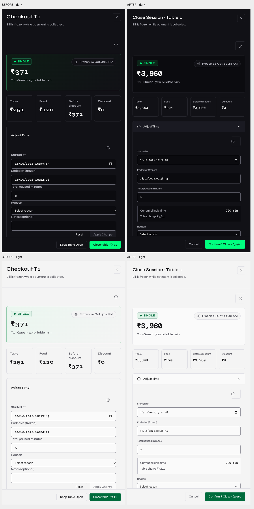

# Interaction Polish

## Scope

Detail and interaction fixes on `codex/interaction-polish`, based on main
`945e63c`. Syne + DM Mono, the approved light/dark palette, table-state fills,
trusted Staff time-edit access, backend permissions and billing calculations
remain intact. This is not a new dashboard layout or a new feature rollout.

## Visual Evidence

Before is the saved, unchanged main build, not a reconstruction. After is a
local production-style build with disposable QA records. Amounts and timers
vary because the seeded sessions continue running between captures.

[All dark screens](all-routes-dark.png) · [All light screens](all-routes-light.png)
· [Full-resolution before](before/) · [Full-resolution after](after/)

## Faults And Fixes

| Page / Component | Actual Fault | Fix Applied | Evidence |
| --- | --- | --- | --- |
| Checkout: Adjust Time | Bare `summary`, transparent background, no edge or chevron; fields ran directly into adjacent labels. | Shared 48px disclosure button, clock icon, rotating chevron, outlined group, token spacing and multiline notes. Reset is ghost; Apply is primary and reason-gated. | [Before](before/checkout-adjust-1440-dark.png), [after](after/checkout-adjust-1440-dark.png); `CheckoutControls.jsx:57` |
| Checkout: customer identity | Buttons exposed `aria-pressed`, but selected styling required a missing class. | Selected segment is visibly filled in both themes; the customer/member behavior is unchanged. Member loading uses a skeleton. | [Mobile after](after/checkout-payment-375-light.png); `CheckoutControls.jsx:41` |
| Checkout: dismissal | Esc, close and Cancel discarded edits without confirmation; Drawer lacked Modal's focus trap. | Guard applied and unapplied edits; nested discard confirmation; only top dialog handles Tab/Esc; restore opener focus. Block dismissal while finalizing. | [Dark confirmation](controls/discard-dark.png), [light](controls/discard-light.png); `CheckoutPanel.jsx:227` |
| Checkout: payment / footer | Supporting and final actions lacked a consistent hierarchy. | Equal-width 48px payment options; clear selected state; disabled Credit remains explained. Cancel + Confirm & Close, fixed-size pending feedback. Mobile targets stay at least 44px. | [Dark pending](controls/closing-dark.png), [light](controls/closing-light.png) |
| Shared controls | Tooltips appeared immediately; native dropdown chevrons depended on surrounding CSS; help icons had no frame. | 300ms hover tooltip, explicit Lucide select chevron, hover/focus/pressed states, framed help controls. Native select semantics retained. | `ui/Field.jsx:27`, `interaction-polish.css`; [shared checks](shared-controls/controls.json) |
| Settings | Session preferences were raw checkboxes; initial load was a text paragraph. | Shared animated switches with visible position change; content-shaped loading; primary Save. No permission values changed. | [Before dark](dialogs/settings-before-dark.png), [after dark](dialogs/settings-after-dark.png), [before light](dialogs/settings-before-light.png), [after light](dialogs/settings-after-light.png) |
| Bookings / cafe / Advanced Controls | Custom dialog paths lacked shared focus containment; History also lacked dialog semantics. | Reused the shared focus helper, added dialog labels, scoped Esc and pending-dismiss guards. | [Dialog checks](dialogs/results.json); before/after captures in [dialogs](dialogs/) |
| Eight header actions | Same-page navigation did not start, export, refresh or open anything. | Removed misleading duplicates; retained working actions beside their content. | [Actual click observations](header-actions-before.json) |
| Bookings header | Early click before the lazy page mounted was lost by a window event. | Persist request in the existing `action` route query; consume after mount. | [Before](booking-header-before.json), [after](booking-header-after.json) |
| Legacy presentation / typography | 342 static inline declarations across seven files; extra-heavy weights mixed with the shared scale. | Deduplicated into 97 shared CSS rules; spacing uses existing tokens. Kept dynamic chart dimensions and semantic state styling data-driven. Shared heavy weights cap at 600; mono amounts stay 500. | `legacy-presentation.css`, `design-tokens.css`; [route measurements](routes/measurements.json) |
| Login | Error appeared below submit and vanished after three seconds. | Persistent error above submit. Existing username/password auth and page structure retained. | `components/Login.jsx`; scanner includes filled fields and failed login |

The removed header labels were: Advanced Controls **Start Table**, Cafe POS
**Place Order**, Tournament Hub **Create Bracket**, Daily Closing **Review
Close**, Analytics **Export Reports**, Pricing **Add Rate Rule**, Inventory
**Add Item**, Audit **Refresh Audit**. None made a REST request or changed URL
in the baseline click check. Other minor DOM mutations were render activity,
not evidence that the action worked.

## Acceptance Evidence

- [Full contrast scan](contrast.json): 27 route/query contexts, both themes,
  including menus, command palette, login failure and safe actions.
- [Route measurements](routes/measurements.json): 74 desktop/mobile samples;
  typography, overflow, shared controls, keyboard navigation and weight guard.
- [Checkout checks](controls/results.json): trusted Staff time preview, reason
  requirement, reset, selected segments, nested confirmation, focus restoration,
  payment pending/failure, no duplicate close, 375px/414px target sizes.
- [Custom dialogs](dialogs/results.json): both themes, forward/reverse Tab,
  Esc, contrast and switch movement, with before/after screenshots.
- [Shared controls](shared-controls/controls.json) and
  [async buttons](async-buttons.json): immediate feedback, no size jump,
  duplicate-click lock, tooltips, skeletons and failed-save behavior.
- [Shell regression](shell/results.json): menus, shortcuts, role boundaries,
  sandbox isolation, saved state, SSE degradation/recovery and mobile bounds.
- [Financial/session regression](session-regression/results.json): local cash
  and member-credit close, name-only identity, food-order changes, two isolated
  origins, reconnect, forced SSE 503, burst debounce and mobile layouts.
- Implementation commit: `1e2701d`. The exact production bundle is verified in
  [deployment.json](deployment.json) after merge and push.

## Production Sign-Off

- Main fast-forwarded from `945e63c` to `20312c7`; no conflicts or changes to
  unrelated worktrees. Implementation and evidence are separate commits.
- Vercel reports a successful deployment for `20312c7`.
- Production entry: `index-D1S5yNYe.js`. All 22 JS/CSS assets returned 200 and
  matched the local production build's SHA-256 values exactly.
- Backend `/health`: 200, revision
  `e014ff4caf9182797dc4e341f6c491fad80bfafa`; required backend ancestor confirmed.
- `/ready`: 200, `database: ok`. Backend source and dependencies were not changed
  by this pass, so no PostgreSQL schema/dependency change was introduced.
- Local QA cleanup confirmed zero rows in every disposable database table.
  Temporary QA servers were stopped. Production business mutations: zero.

Completed checks: lint, production build, theme-token guard, backend syntax,
shared realtime-manager tests, 27-context contrast scan (0 violations / 0
errors), 74 route/viewport samples, 12 dialog checks and 10 checkout checks.
The final checkout run measured visible pending feedback at 4ms dark / 3ms
light, with no size shift and no duplicate close request. The deliberately
delayed booking-page test changed from `dialogOpened: false` to `true`.

The financial regression completed 20 checks and 24 screenshots with zero
contrast violations or page errors. Five measured food mutations propagated
in 199–310ms. A ten-mutation burst collapsed to two floor reads across both
origins (14 REST requests including the ten writes and two alert reads).
Reconnect recovered in 646–653ms; forced SSE 503 retained the existing polling
fallback, updating in about 14 seconds. Cash and credit closes both succeeded;
name-only checkout did not create a member. All disposable local QA tables
were cleared after verification. No production business records were changed.

## Deliberate Constraints

- Trusted Staff keep time editing, as explicitly confirmed by the user.
- Dark neon primary surfaces use the existing dark foreground, not white text
  that would fail contrast. Light primaries retain their existing foreground.
- Mobile controls remain 44px or larger rather than shrinking to a literal
  desktop-only 32px/40px specification. Letter spacing remains zero.
- The existing checkout Drawer and login structure are retained under the
  no-layout-redesign instruction. No fake email login, Add Tables, imports,
  subscriptions or other unavailable functionality was introduced.
- Browser-native select popups remain browser controlled; the field and
  chevron have shared styling. No claim of animating the operating-system popup.
- One source-scan candidate, `CustomerInput`, is unused in the live view. Its
  accessibility hardening is not counted as a verified live-page button fix.
- Test interruptions/timeouts are not counted as passing evidence. Reports
  linked above must be from completed runs; all data mutations are local QA.
