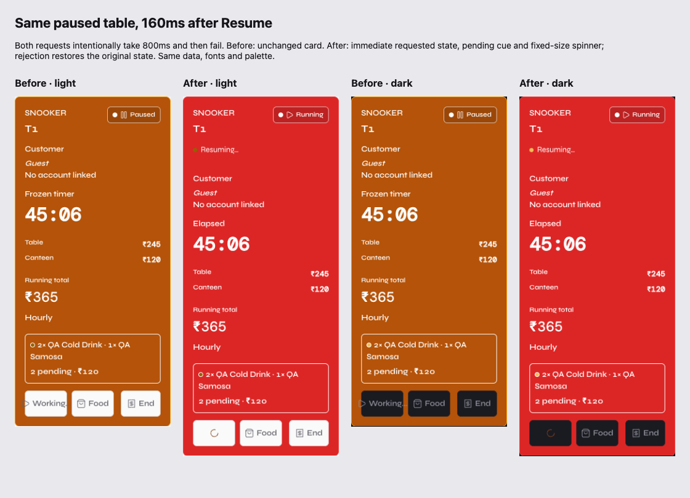

# Perceived speed: measured frontend changes

2026-10-14. Baseline: `f535d69`. Local business fixtures only; no production
account, order, session, stock or payment was changed during verification.
Approved Syne + DM Mono fonts and both palettes are unchanged.

## Diagnosis before fixes

| Finding | Actual evidence |
| --- | --- |
| Most handlers already set busy before awaiting | Pause immediately disabled, but kept its old status/timer until the response and floor refresh. No universal claim that loading began late. |
| Typing caused unnecessary work | Nine-character optional checkout name: 20 requests in each theme, including 10 previews and unrelated floor/alert/summary reads. |
| Re-renders spread beyond the changed table | React Profiler: 115/130 card-boundary updates, 275.0/283.9ms cumulative card render work in the light/dark test sequences; idle cards updated too. |
| Navigation shell was already retained | Sidebar/topbar outside Suspense; the defect was cold page state and absent hover/focus module prefetch, not shell teardown. |
| No hydration queue | This is Vite client-rendered React, not Next.js. Baseline entry 379.68kB raw / 121.95kB gzip, with lazy route chunks. Warm local reads generally 6-99ms; cold initialization was slower. These are local timings, not a production-server benchmark. |
| SSE could stay silently stale | One shared stream already existed; a connected stream had no missed-heartbeat watchdog. Heartbeats also reached generic domain subscribers. |

Raw observations: [before measurements](before/measurements.json),
[before light profiler](before/profiler-light.json),
[before dark profiler](before/profiler-dark.json).

## Applied

- Shared standard/native/icon buttons: CSS pressed feedback on pointer-down,
  pending state before invoking handlers, fixed dimensions, spinner and a
  synchronous promise lock. Native DOM structure remains compatible with old CSS.
- Live Floor: optimistic start/pause/resume and canteen add/serve/quantity/cancel,
  labelled pending state, isolated rollback, stale-response guard. Closing shows
  pending until the real bill commits. Its card cannot be used as a second close.
- Inventory/waitlist/workspace actions: reversible data overlays; customer and
  booking creation/cancellation/removal update locally and reconcile. Existing
  restore endpoints retain five-second Undo; non-restorable actions keep confirm.
- Plain checkout names remain local drafts, committed with the real close; no
  per-keystroke pricing call. Member/time changes still request authoritative
  quotes. Failed forms keep their values and show inline errors.
- Hover/focus preloads route modules. Core operating pages reuse bounded,
  token/role-scoped 30-second in-memory data while refetching. Auth, signed quotes,
  receipts and security settings are not cached. Content skeletons retain shapes
  without supplementary spinners; shell remains mounted.
- Concurrent safe reads deduplicate. Domain events and successful writes advance
  a read epoch so a remote invalidation cannot reuse an older in-flight read.
  Read-only previews/auth do not broadcast data changes. Floor/alert listeners
  filter unrelated local mutations; summary refreshes debounce.
- Memoized toast/alert context values and table cards; idle cards no longer tick.
  No new state framework or backend implementation was introduced.
- No `transition: all`; hover 80ms, press 60ms, tabs 120ms, modal open 150ms,
  toast in/out 150/120ms, notification popover 100ms. Invisible page-entry fade
  removed. Existing unmount-on-close overlays remain immediate, not delayed.
- Existing 15-second server SSE heartbeat: after 35 seconds of silence, abort,
  enter polling fallback and reconnect with the existing backoff. Heartbeats do
  not trigger refetches. Stream count remains one per tab.

## Measured acceptance

| Check | Result / artifact |
| --- | --- |
| Same name-entry sequence | 20 -> 1 requests per theme; zero preview calls for a plain optional name. [After](after/measurements.json) |
| Card Profiler cumulative work | Light 275.0 -> 95.7ms; dark 283.9 -> 98.6ms, about 65% less. Boundary callbacks include memo bailouts; these are not all full component renders. [Light](after/profiler-light.json), [dark](after/profiler-dark.json) |
| Production-build interaction suite | 18 checks across both themes: immediate pending, 409/422 rollback, no false paid receipt, retained drafts, warm cached return, same shell DOM, zero overflow at 375/414/1440px. [Results](verification/results.json) |
| Button contract | Standard/native/icon: two synchronous clicks -> one call; visible spinner; width/height shift 0px. Pointer-down brightness verified before click in both themes. [Results](async-buttons.json) |
| Cross-session delivery | Two isolated origins; order changes 160-270ms, reconnect 646/652ms, real forced-503 fallback updates 13.97/14.00s. Ten writes -> two floor reads across both sessions (14 total REST requests including writes). Cash/name-only and member-credit close still pass. [Results](session-regression/results.json) |
| Alert dismissal | Immediate unread removal, rejected acknowledgement restores it; normal toast not replayed, urgent reminder restored once. [Results](alert-replay.json) |
| Visual / contrast | 24 session-flow captures plus before/after and mobile feedback captures. Both themes. Whole-app scanner: 17 routes, 0 violations, 0 errors. [Contrast](contrast.json) |
| Build safeguards | Lint, production build, theme guard, backend syntax, shared-stream/watchdog test, scanner real-violation fixture pass. |

Final sampled pending-state DOM updates: 2.3-4.0ms on the local production build,
with zero button dimension changes. This is not a claim about every physical
display's paint cadence.

## Shipped

`76e5ef762b7a315c2fb56f5f814e7cffab1770f5` was fast-forward merged and pushed to
`main`. Production verification at 2026-10-14 14:25 UTC confirmed all 21 JS/CSS
assets match the production-targeted build byte-for-byte, including entry
`index-BYJuUkPM.js`. Backend `/health` and `/ready` returned 200; database ready.
The unchanged backend revision `23e06de` contains the required session-food/credit
backend commit `d8acfaa`. [Exact hashes and ancestry](deployment.json).

Temporary QA servers were stopped. Guarded local cleanup confirmed **0 rows in
all disposable database tables**. No production mutation or new account occurred.

The image uses identical frozen data and an 800ms request deliberately rejected
with 409. Before, the card stays Paused; after, it immediately shows Running and
Resuming with a spinner, then returns to Paused on rejection. Separate full-page
captures are in `before/`, `after/`, `verification/` and `session-regression/`.

## Boundaries, not synthetic success

- DOM feedback measurements are on this test machine, not a guarantee of a
  physical paint within 16ms on every device. CSS pressed feedback is immediate;
  sampled async feedback is below the requested 100ms target.
- Payments, signed totals, member-rate recalculation, security/configuration and
  irreversible operations remain server-authoritative. No guessed bill or fake
  receipt is presented optimistically. Legacy controls retain their existing
  busy/confirmation paths rather than a second speculative billing model.
- Current SSE events have no client request ID. We do not discard an unknown
  event as a self-echo; debounce/read deduplication preserves remote changes.
- The large inherited stylesheet was not rewritten or purged. No measured
  long-list bottleneck justified adding a virtualization dependency in this pass.
- Cold starts and network outages can still delay confirmation. Pending state is
  visible, retries do not resend mutations, and polling remains available.
- Contrast capture now waits for finite opening animations and retries if the
  route/modal surface changes between text collection and pixel sampling. The
  separate fixture still detects deliberately bad visible text.

## Repeat locally

Use the guarded local seed and API on port 8006; two frontend origins 5181/5180.
`verify-perceived-speed.mjs` is best run against a production-mode local build.
`measure-perceived-speed.mjs` needs the development build for opt-in React
Profiler data (`sessionStorage hsr:profile=1`); collection is disabled in production.
`compare-perceived-speed.mjs` additionally uses the untouched baseline on 5182.
`test-async-buttons.mjs` uses development module imports for an isolated harness.
Never aim these mutation/fixture scripts at production. Deployment byte hashes
and backend ancestry are recorded separately in `deployment.json` after shipping.
