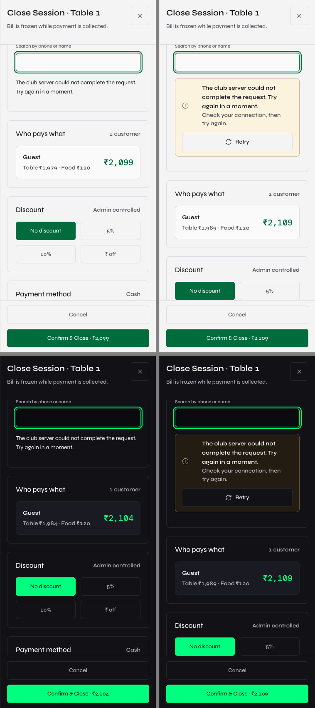
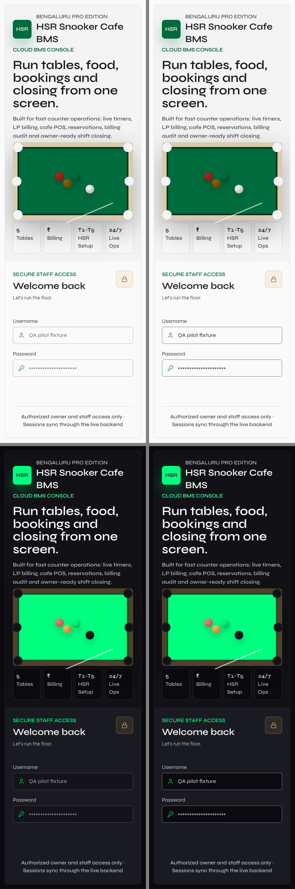
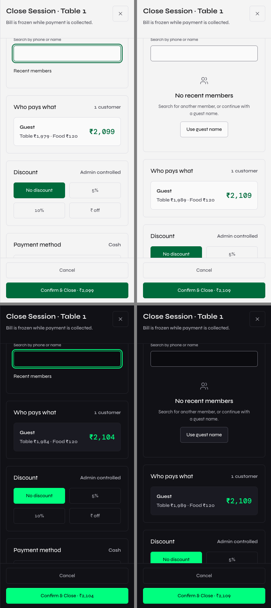
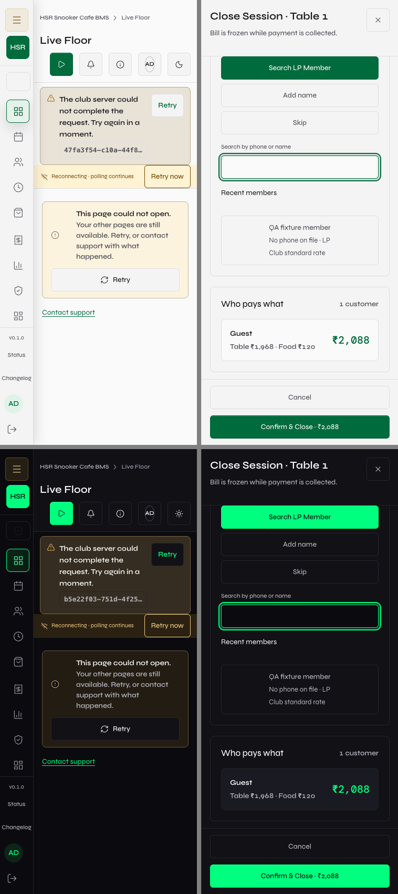

# Pilot UI Gate

The October 22 minimum is stricter than the earlier UI-readiness scan: all
rendered text must reach 4.5:1, including large text and disabled controls.
The previous WCAG large-text and disabled-control exemptions are not a pass
for this gate. Preserve the approved Syne / DM Mono fonts and both palettes.

## Reproduced Failures and Fixes

| Area | Before | Fix / verified after | Evidence |
| --- | --- | --- | --- |
| Pending login | Disabled username/password were 3.35:1 in light mode | Shared disabled fields no longer fade the entire control; painted text is 7.41:1 light / 9.55:1 dark at 375px and 1440px | [Before](before/results.json), [after](after/results.json), [comparison](comparisons/login-pending.png) |
| Checkout member failure | Plain error text, no recovery action | Shared Retry notice; clicking retries the read and immediately shows the existing skeleton | [Comparison](comparisons/member-error.png) |
| Checkout member empty result | Plain status text without an action | Shared icon/headline/description and working "Use guest name" action | [Comparison](comparisons/member-empty.png) |
| Malformed member results | A null row broke the route | Validate the collection, discard missing-ID rows, render the valid result; shared choice content stacks within the mobile panel instead of expanding it | [Comparison](comparisons/member-partial.png) |
| Adjust Time | Already an actionable shared Disclosure | No redesign: verified clock, chevron, 1px container border, expansion, 44px mobile / 48px desktop target | [Measurements](after/results.json) |
| Scanner false reassurance | Default mode exempts disabled controls and allows large text at 3:1 | Explicit strict pilot mode requires 4.5:1, includes disabled text, and reads actual text-fill paint rather than only CSS color | [Regression tool](../../frontend/scripts/test-pilot-ui-gate.mjs) |

## Measured Coverage

- Focused regression: 4 configurations (both themes at 375/1440px), 8 states
  each, 32 captures. Zero contrast violations, page errors, horizontal content
  overflow, undersized measured targets, missing control labels, or invalid copy
  in the captured states. Browser business writes blocked; none attempted.
- Strict route scan: 27 reviewed paths including Settings subroutes and a 404,
  both themes, loaded data plus safe actions, command palette and popovers.
  Zero violations and zero runtime errors. [Raw result](routes-after.json);
  the previous default-route baseline was also
  zero, so only the held pending-login test exposed the disabled-text fault.
- Shared button feedback: 6.8ms dark / 2.7ms light, stable 162.25px button width,
  visible spinner, bounded tooltip. Fourteen held-read checks (seven pages in
  both themes) displayed skeletons. Failed Settings reads showed Retry and did
  not expose editable fallback defaults. [Raw result](controls/controls.json).
- Scanner guards deliberately detect low-contrast large/disabled text while
  excluding clipped/occluded text, and detect a disabled input whose actual
  text-fill is weaker than its CSS color. These are expected failing fixtures,
  not app violations.
- Lint, theme-token guard, backend syntax and production build passed. No backend source or
  dependency changes; no production business mutations or credential attempts.

## Visual Evidence

Before is left; after is right. Light above dark. Original pixels, no retouching
or resizing. The local running-session amount naturally advances between runs.
Full 375px/1440px screenshots are retained in `before/` and `after/`.

## Scope and Remaining Gates

This is not a claim that every theoretical hidden button/permission/state
combination has been exercised. The broad responsive loading/error/empty/partial
coverage remains in [the earlier readiness report](../ui-readiness/README.md).
Raw button/input/select/textarea/table primitives are confined to shared UI
files. Specialized domain cards still exist; this pass did not migrate every
card layout to one universal Card or rebuild Dashboard's local KPI composition.
That literal component-consolidation requirement is therefore not certified.
Native select popups remain OS-rendered. No brand, billing, permission or SSE
rollout changes. The separate security, restore and real-club pilot gates remain.

## Re-run

Use the disposable database and preview setup described by
`frontend/scripts/test-pilot-ui-gate.mjs` (API 8006, preview 5181), never production
credentials. Run `node scripts/test-pilot-ui-gate.mjs after`. For the broad scan,
set `CONTRAST_APP_URL`, `CONTRAST_API_URL`, `CONTRAST_STRICT_PILOT=true` and a new
`CONTRAST_REPORT_PATH`, then run `npm run scan:contrast`. Include the reviewed
Settings subroutes and 404 using `CONTRAST_EXTRA_ROUTES`. The focused tool blocks
all business writes and intercepts the login submission/member lookup fixtures.

## Release

Merged by fast-forward and pushed to `main` at `83da816`, without conflicts.
[Production verification](deployment.json) confirms all 23 release JS/CSS
SHA-256 hashes match. Frontend, backend health and database readiness return
200. The unchanged backend revision is
`e014ff4caf9182797dc4e341f6c491fad80bfafa`, with ancestry verified.
[Live login checks](production-login/results.json): both themes at
375/768/1024/1440/1920px, strict 4.5:1 scan, zero faults or page errors and zero
credential submissions. Authenticated checkout cases were verified locally,
not by making production transactions.
Disposable local QA database cleaned: zero rows in every guarded QA table.
Temporary QA servers stopped; the user's existing checkout/server was untouched.
