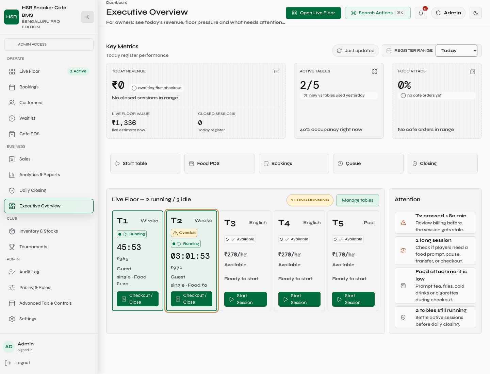
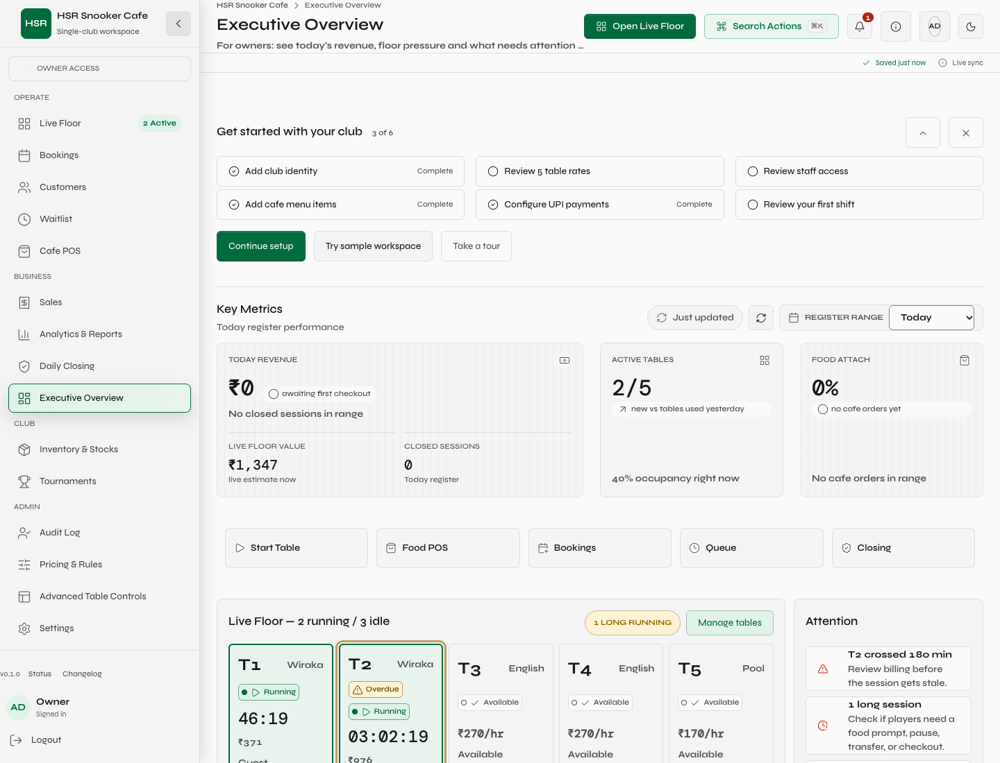
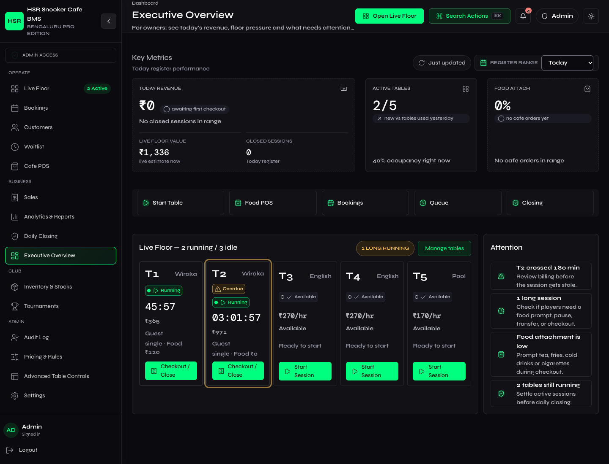
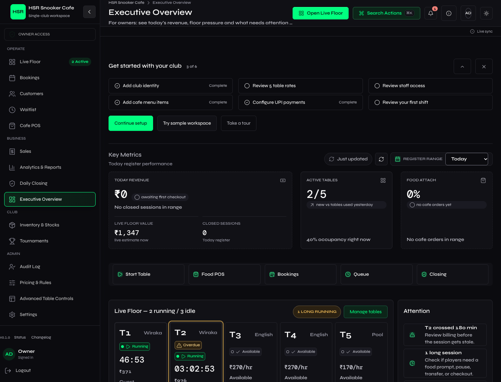
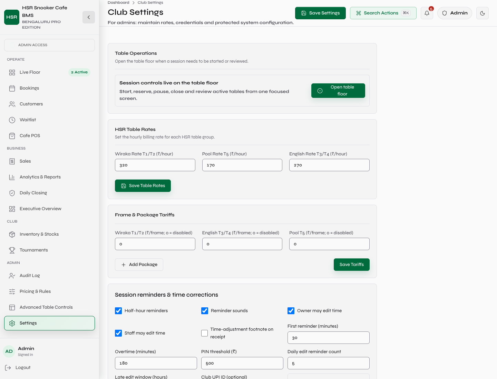
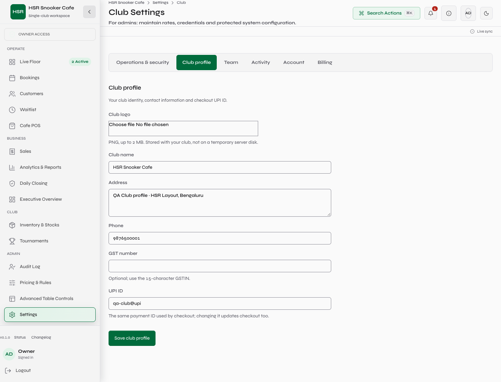
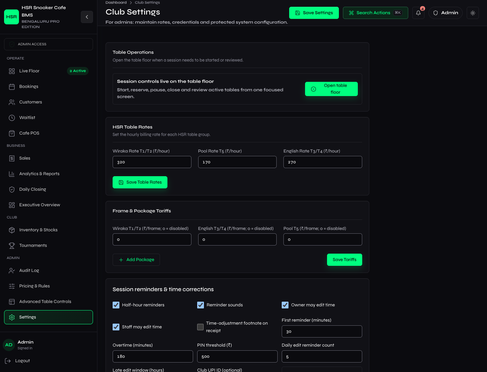
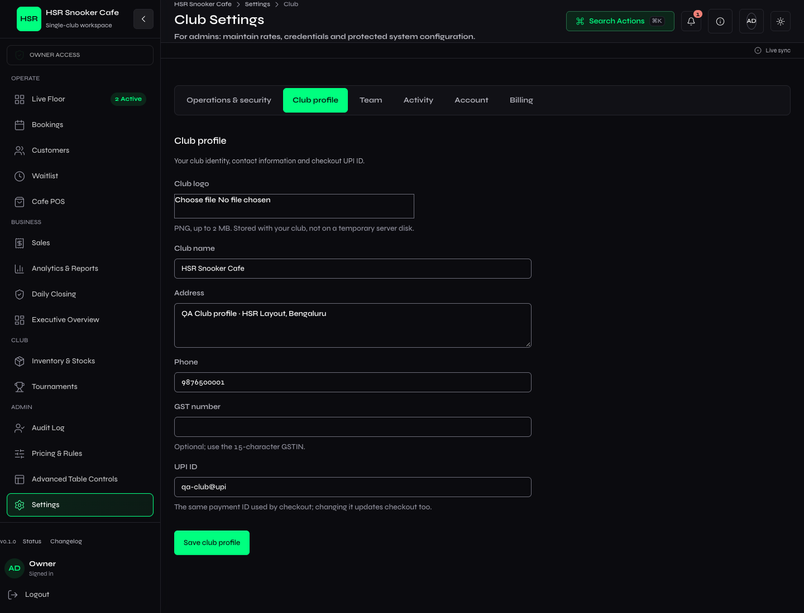
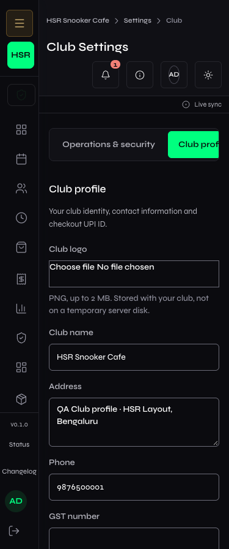

# Product Shell

Scope: complete the shell around the existing single-club application, without
changing the approved Syne / DM Mono fonts, theme tokens or table-state colors.
Support contact supplied by the owner: **shivanshg2510@gmail.com**.

## What Changed

| Area | Delivered | Evidence |
| --- | --- | --- |
| Club identity | Database-backed name, bounded PNG logo, address, phone, GSTIN and the existing checkout UPI setting | Club Profile save/reload and backend concurrency tests |
| Chrome | Club menu, Owner/Staff user menu, help menu, nested Settings breadcrumbs, actual package version | Both-theme route screenshots |
| Setup | Six real checks, collapse/dismiss persistence, complete confirmation, first-shift guide and skippable four-step tour | Browser setup checks; backend setup test |
| Sample workspace | 10 synthetic members, five tables, three bookings and cafe orders; local state changes and deletion | Browser observed **zero backend writes** |
| Trust | Saved only after successful writes; SSE observer/retry/offline feedback; report freshness and refresh; Dashboard refresh | 409 rejection, forced 503, reconnect and offline tests |
| Account | Real customer/table/login counts, shared-role access, explicit no-subscription state | Permission and response-shape tests |
| Activity | Stored audit events, actor/action/India-date filters; latest 200 events clearly stated | Browser filter test |
| Help/recovery | Internal guides, configured support, contextual checkout/time/credit help, 404 and retryable render boundary | `recovery.json`, real boundary failure/recovery harness |
| Shortcuts | Command palette, ?, G-D/M/B, N and focused-table P/R/E/O; typing/modal guards | Browser keyboard checks |

## Honest Boundaries

- Still one club, with Owner and shared Staff credentials. No individual staff
  invitations, Manager/Counter roles, club switching or multi-tenant isolation.
- No paid subscription, quota or subscription invoice system. Billing states this
  plainly and links to actual club Sales; no non-working Upgrade/Invite controls.
- Existing tables are reviewed rather than pretending an Add Tables feature exists.
  The sixth setup item is a first-shift guide, not nonexistent QR-code printing.
- Sample records live only in the sample page's React state and disappear when
  leaving. They never enter production, operational pages or financial reports.
- No fake CSV import, public booking link, uptime percentage or telemetry claim.
- Status makes an actual readiness request. Render keep-alive remains best effort.
- The existing 24-hour/no-refresh authentication limitation remains documented;
  this pass does not change credentials or create production users.

## Verification

- Fresh environment installed directly from backend requirements, then imported
  the app using production-shaped `postgresql+psycopg://` against disposable
  Postgres 16. No new dependencies.
- Local Postgres: 10 product-shell tests, 34 session-engine tests, 16 authentication/
  financial-integrity tests, 16 session-control tests, 28 food/credit suite tests
  (which also include the session-control cases), migration upgrade/rollback.
- One complete Postgres soak: **87 requests, PASS**, three sessions closed,
  three ledger checks and zero active sessions remaining.
- Backend source `e014ff4` passed [production-parity CI](https://github.com/KingShivesh/hsr-bms/actions/runs/38874691714)
  before merging. It deployed ahead of the UI; production `/health` confirmed that
  exact revision, not just a successful push.
- Frontend: lint, build, theme guard, shared-manager regression, real contrast
  scanner self-tests, alert replay, shell and render-recovery browser tests.
- `verification/results.json` contains route/theme measurements and the screenshot
  manifest. Desktop: 20 routes and five additional Settings sections, both themes.
  Mobile: 375px/414px, both themes, including real element-bound checks.
- Visual inspection caught clipped mobile profile inputs and crowded topbar text
  despite a passing document-overflow check. Fixed the container min-width/grid
  constraints and mobile chrome, then strengthened the check and reran it.
- First-login browser testing caught two competing redirect paths. Both now send
  Owners without a requested destination to the Dashboard/setup; Staff still go
  to the Live Floor. Requested protected destinations remain preserved.
- The chrome observes realtime state without adding a topic subscriber. A burst
  of ten manual retries keeps the physical stream maximum at **one**; observers
  clean up. Existing degraded polling is untouched.

Final scanner output: `contrast.json`. Deployment byte hashes, readiness and
backend ancestry: `deployment.json` (added only after live verification).

Production confirmed after merge: **22/22 JS/CSS SHA-256 matches**, entry
`index-CkBsgI2a.js`; backend revision `e014ff4caf9182797dc4e341f6c491fad80bfafa`,
readiness HTTP 200 and database `ok`. Both product-shell branches are ancestors
of main. Source commit: `383a53b`; visual-evidence commit: `e3ff181`.
No production account was created and no production business records were changed.
The isolated local QA database was cleared to **zero rows in every table** and
the temporary Postgres test container and QA servers were removed/stopped.

Final expanded scan: **27 route/query contexts, light + dark, 0 violations,
0 errors**, including club/help/user menus and the real 404. The 404 support link
initially inherited Bootstrap blue (4.31:1 light / 4.36:1 dark); shared empty-state
and recovery links now use the existing accent text token, and the full rerun
passed. No palette values were changed.

Desktop topbar height remains **77px**. Computed fonts remained `Syne Variable`,
Syne, sans-serif; accent values remained `#006B3C` / `#00FF7F`.
There are 82 route/mobile/before-after screenshots plus eight menu/tour screenshots.
`comparison.png` combines the four actual Dashboard captures for direct viewing.

`session-regression/results.json` records the unchanged operating flows: 24 more
screenshots, zero contrast errors, name-only cash checkout and member-credit
checkout, two origin-isolated sessions, network recovery and forced-503 fallback.
Order changes propagated in 208-502ms. A ten-order burst produced only two floor
reads across both sessions (14 REST requests including the ten writes and two alert
reads), in each theme. Alert replay and retryable render recovery also passed.

## Actual Screenshots

Local QA only. These are working application pixels, not mockups. Operational
figures naturally advance with the running local sessions. The complete set,
including every tested route and mobile width, is in `verification/`.

| Before | After |
| --- | --- |
|  |  |
|  |  |
|  |  |
|  |  |

